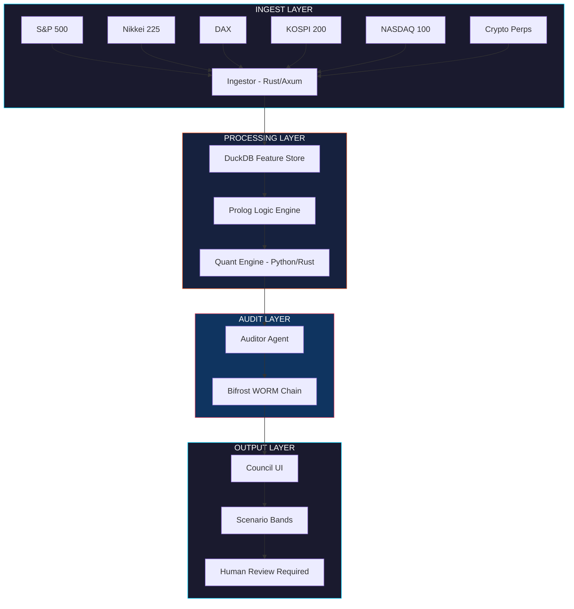

# MARKETSCOPE

**Sovereign Market Intelligence & Research Platform (MIRP)**

```
ORCHESTRATOR      Ahmad Ali Parr
EXECUTION         SNAPKITTYWEST sovereign stack
SEALED            2026-07-04
STATUS            v0.1 · Sovereign architecture · 5 agents
AUDIT             4b565498-9afc-4782-af4a-c6b11a5d0058
```

---

## I. What This Is

MARKETSCOPE is a sovereign market intelligence platform that:

1. **Ingests** global index data (S&P 500, Nikkei, DAX, KOSPI, etc.) via sovereign connectors
2. **Processes** signals through a Prolog Logic Layer (deterministic rules, regime detection, correlation logic)
3. **Logs** every inference, data snapshot, and model weight to the Bifrost WORM Chain
4. **Outputs** probabilistic scenario analyses (not predictions) for Human Review Required

## II. What This Is NOT

This is **NOT** a trading system. This is **NOT** financial advice.

```
╔══════════════════════════════════════════════════════════════╗
║  PROHIBITED ACTION: financial_advice                        ║
║                                                              ║
║  This platform produces SCENARIO BANDS, not point forecasts. ║
║  All outputs require Human Review Required before any action.║
║  The Prolog Logic Layer enforces this at the type level.     ║
║                                                              ║
║  Training_Gate: Human_Review_Required                        ║
║  Audit_Spec: 4b565498-9afc-4782-af4a-c6b11a5d0058          ║
╚══════════════════════════════════════════════════════════════╝
```

## III. Architecture



## IV. Agent Roles

| Agent ID | Role | Sovereign Constraint |
|----------|------|----------------------|
| `INGESTOR_GLOBAL` | Pulls OHLCV + Alt Data (futures basis, funding rates) | Plasma Gate `Ed25519` verify each payload |
| `PROLOG_REASONER` | Fires deterministic rules (regime, correlation, breadth) | **Zero hallucination** — pure logic |
| `QUANT_ENGINE` | Runs conformal prediction / quantile forests (Python/Rust) | Model weights + data hash → Bifrost WORM |
| `AUDITOR` | Verifies lineage: Raw → Feature → Inference → Output | `Audit_Spec: 4b565498-9afc-4782-af4a-c6b11a5d0058` |
| `COUNCIL_UI` | Presents **scenario bands** (not point forecasts) | `Training_Gate: Human_Review_Required` |

## V. Repository Layout

```
market-scope/
├── apps/
│   ├── ingestor/          # Rust (Axum + Reqwest) — sovereign data connectors
│   ├── logic-engine/      # SWI-Prolog (HTTP JSON API) — deterministic rules
│   ├── quant-engine/      # Python (Polars + LightGBM + Conformal) — scenario bands
│   ├── auditor/           # Rust (WORM Writer + Verifier) — lineage verification
│   └── council-ui/        # Next.js + Tailwind — scenario visualization
├── packages/
│   ├── schemas/           # Protobuf / JSON Schema (shared types)
│   ├── prolog-rules/      # .pl files (versioned, tested, WORM-hashed)
│   ├── connectors/        # Per-index connector configs
│   └── bifrost-sdk/       # Rust/TS SDK for append_block(), verify_chain()
├── docker-compose.yml     # Local stack definition
├── turbo.json             # Turborepo pipeline definition
├── worm-genesis.json      # Genesis block for the WORM audit chain
└── README.md              # This file
```

## VI. Prolog Logic Layer

### Market Regime Detection (Deterministic)
```prolog
regime(bull) :- sma_50 > sma_200, vix < 20, breadth > 0.6.
regime(bear) :- sma_50 < sma_200, vix > 30.
regime(transition) :- \+ regime(bull), \+ regime(bear).
```

### Correlation Breakdown Alert
```prolog
correlation_breakdown(AssetA, AssetB, Window) :-
    rolling_corr(AssetA, AssetB, Window, Corr),
    Corr < 0.3,
    historical_avg_corr(AssetA, AssetB, Avg),
    Avg > 0.7.
```

### Sovereign Compliance Guard
```prolog
compliant_signal(Signal) :-
    source_verified(Signal),
    worm_logged(Signal),
    \+ prohibited_action(financial_advice),
    human_review_gate_passed(Signal).
```

## VII. Quick Start

```bash
# Clone the repo
git clone https://github.com/SNAPKITTYWEST/market-scope.git
cd market-scope

# Start local stack
docker compose up -d

# Verify services
curl http://localhost:8080/health   # Prolog engine
curl http://localhost:3001/health   # Ingestor API
curl http://localhost:8090/health   # Auditor
```

## VIII. Sovereign Constraints

| Constraint | Enforcement |
|------------|-------------|
| `prohibited_action(financial_advice)` | Prolog guard — all outputs are scenario bands |
| `Training_Gate: Human_Review_Required` | UI blocks autonomous execution |
| `Audit_Spec: 4b565498-9afc-4782-af4a-c6b11a5d0058` | WORM chain — append-only, SHA-256 sealed |
| `Plasma Gate Ed25519` | Every data payload cryptographically verified |
| `Zero hallucination` | Prolog Logic Layer — pure deterministic rules |

---

*This repository is a sovereign research platform. It does not provide financial advice.*
